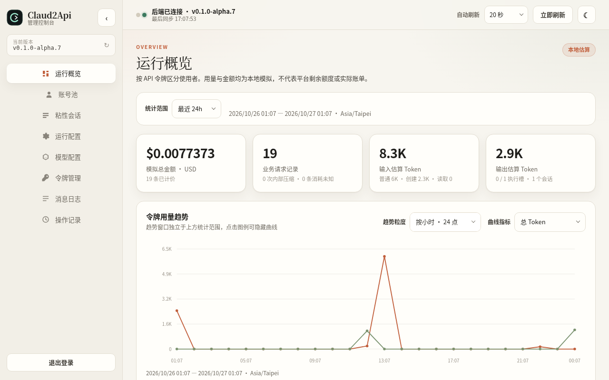
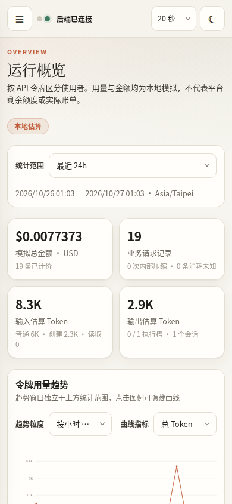

<p align="center">
  
</p>

<h1 align="center">Claud2Api</h1>

<p align="center"><strong>Claude 网页端 → Anthropic Messages API 网关</strong><br/>私有管理控制台 · 账号池 · 自更新守护</p>

<p align="center"><strong>v0.1.0-alpha.7</strong></p>

<p align="center">
  
  
  
  
</p>

<p align="center">
  
  
</p>

---

## 目录

- [项目简介](#项目简介)
- [来源与致谢](#来源与致谢)
- [功能特性](#功能特性)
- [快速开始](#快速开始)
- [管理控制台](#管理控制台)
- [API 使用](#api-使用)
- [安全与风控](#安全与风控)
- [开发](#开发)
- [免责声明](#免责声明)
- [许可证](#许可证)

## 项目简介

Claud2Api 是一个用 Rust 编写的 Claude 网页端 → Anthropic Messages API 网关。它把 claude.ai 网页会话的能力——图片、PDF、文本附件、客户端工具、网页原生搜索与读取、Artifacts、远端代码沙箱、信息卡片和项目知识——桥接为标准 Messages API，并附带账号池、私有管理控制台、令牌、会话、用量统计与自更新守护。

适合自用、研究和内部集成，不是 Anthropic 官方产品，也不提供账号或额度。

## 来源与致谢

本项目**基于原作者 [Saito-Sakuya/Claud2Api](https://github.com/Saito-Sakuya/Claud2Api) 的代码重构与扩展**。

| | |
|---|---|
| 原始项目 | [Saito-Sakuya/Claud2Api](https://github.com/Saito-Sakuya/Claud2Api) |
| 原作者 | **Saito-Sakuya** |
| 上游基线 | `v0.1.0-alpha.7`（commit `d533e6e`） |
| 上游许可证 | MIT（本仓库保留原始版权与许可声明） |

原始架构、协议适配、浏览器指纹传输层、账号池和更新守护均来自原作者。本仓库在其基础上补全了协议覆盖、账号运维、公网安全、界面重做与风控收敛。本项目与 Anthropic 及原作者均无隶属、合作或背书关系。

## 功能特性

### 协议与模型

- `POST /v1/messages`：JSON 与 SSE 流式响应
- `POST /v1/messages/count_tokens`：本地令牌估算，不占用账号调度
- 图片（PNG/JPEG/GIF/WebP）、PDF、UTF-8 文本附件
- 客户端工具通道（`tool_use` / `tool_result`），支持强制工具选择与并行限制
- 网页原生工具组：`web_search`、`artifacts`、`repl`、`widgets`、`project_knowledge`
- 可选扩展思考（`thinking`）：返回标准思考块与上游签名；模型名加 `-thinking` 后缀可直接启用
- `/v1/models` 同时列出每个模型的基础版本与 `-thinking` 版本
- `GET /v1/models`：同时兼容 Anthropic 与 OpenAI 模型对象
- 兼容接口：`POST /v1/chat/completions`、`POST /v1/responses`、`DELETE /v1/conversations/{id}`
- 自定义模型映射、`c2a-` 桥接模型名、粘性会话、上下文压缩、模拟 1h 缓存统计

### 账号池

- 每账号严格串行，最小请求间隔 + 每分钟上限 + 确定性抖动
- 独立浏览器配置（Chrome / Firefox）与代理（HTTP / HTTPS / SOCKS5 / SOCKS5h）
- 5 小时本轮/上轮用量、暂停 / 冷却 / 配额状态、共享代理提示
- 账号存活检测（单个 / 全部，返回可用模型、邮箱与组织）、状态重置、凭据轮换、删除

### 管理控制台

- 账号、模型映射、API 令牌、粘性会话、运行配置、消息日志、操作审计、用量概览
- 管理员会话（默认 8 小时、退出即撤销）、登录失败锁定、来源网段白名单
- 深色 / 浅色主题，桌面与移动端适配，版本管理与回退

## 快速开始

推荐 Linux AMD64 VPS + Docker Compose。控制台支持公网访问，但**必须启用 TLS**，否则程序拒绝启动。

```sh
# 1. 准备目录与密钥
sudo install -d -m 700 /srv/claud2api-private
sudo install -d -m 700 -o 65532 -g 65532 /srv/claud2api-state
sudo python3 scripts/generate_key.py /srv/claud2api-private/gateway-key.txt
sudo python3 scripts/generate_key.py /srv/claud2api-private/admin-key.txt
sudo touch /srv/claud2api-private/accounts.txt
sudo chmod 600 /srv/claud2api-private/*.txt
sudo chown 65532:65532 /srv/claud2api-private/*.txt

# 2. 控制台证书（可信证书或自签名）
sudo python3 scripts/generate_tls.py /srv/claud2api-private --host c2a.example.com --host 203.0.113.10
sudo chown 65532:65532 /srv/claud2api-private/tls-*.pem
```

创建 `/srv/claud2api-private/settings.env`：

```dotenv
CLAUD2API_STATE_DIR=/srv/claud2api-state
GATEWAY_API_KEY_FILE=/srv/claud2api-private/gateway-key.txt
ADMIN_API_KEY_FILE=/srv/claud2api-private/admin-key.txt
CLAUDE_ACCOUNTS_FILE=/srv/claud2api-private/accounts.txt
CONTROL_TLS_CERT_FILE=/srv/claud2api-private/tls-cert.pem
CONTROL_TLS_KEY_FILE=/srv/claud2api-private/tls-key.pem
CLAUD2API_IMAGE=claud2api:local
GATEWAY_PORT=18081
CONTROL_BIND=0.0.0.0:18082
ALLOW_REMOTE_CONTROL=true
SIMULATED_CACHE_ENABLED=true
CLAUDE_TIMEZONE=Asia/Taipei
CLAUDE_LOCALE=zh-CN
```

```sh
# 3. 启动（首次会从源码构建镜像）
sudo chmod 600 /srv/claud2api-private/settings.env
sudo docker compose --env-file /srv/claud2api-private/settings.env up -d --build
curl http://127.0.0.1:18081/health
```

- **控制台**：`https://<服务器地址>:18082/`，使用 `admin-key.txt` 登录
- **公开 API**：`http://<服务器地址>:18081`，使用 `gateway-key.txt` 或控制台创建的令牌
- 账号可从控制台导入，或写入 `accounts.txt`（每行一个 Session Key 或完整 Cookie）

## 管理控制台

登录后可以：

- **账号池**：批量导入、编辑名称、启停、独立浏览器/代理、5h 用量、存活检测、重置状态、更换凭据、删除
- **模型配置**：按账号获取上游目录、补入全部模型、配置下游 ID 与真实模型映射
- **令牌管理**：创建、编辑、删除 API 令牌；完整令牌只显示一次
- **粘性会话**：查看与清理空闲会话
- **运行配置**：会话、请求、调度参数与网页原生工具组开关
- **消息日志**：输入/输出 Token、模拟缓存、状态码、耗时、首字延迟、TPS 与请求 ID
- **操作记录**：账号、配置、会话与登录审计
- **运行概览**：按令牌的用量趋势、占比与模拟费用

## API 使用

```python
from pathlib import Path
from anthropic import Anthropic

client = Anthropic(
    base_url="http://127.0.0.1:18081",
    api_key=Path("/srv/claud2api-private/gateway-key.txt").read_text().strip(),
)
model = client.models.list().data[0].id
message = client.messages.create(
    model=model,
    max_tokens=1024,
    messages=[{"role": "user", "content": "Hello"}],
)
print(message.content)
```

```sh
# 令牌计数（不访问上游）
curl http://127.0.0.1:18081/v1/messages/count_tokens \
  -H "x-api-key: $API_TOKEN" -H "content-type: application/json" \
  -d '{"model":"claude-sonnet-5-5","messages":[{"role":"user","content":"Hello"}]}'
```

- 默认使用账号实际支持的原生模型名；需要区分本服务时可用 `c2a-claude-*`
- 启用自定义模型配置后，请使用 `/v1/models` 返回的 ID
- 思考：请求体加 `"thinking": {"type": "enabled"}`，是否产生思考块取决于账号与模型
- 模型目录查询也占用账号调度，请处理 429 / `Retry-After`

## 安全与风控

- 公网控制台必须启用 TLS：`CONTROL_TLS_*`，或由可信反向代理终止 TLS 并设置 `TRUST_PROXY=true`
- 管理会话默认 8 小时，退出即撤销；连续失败 10 次锁定 15 分钟
- 建议设置 `ADMIN_ALLOW_CIDRS`，并在云防火墙只放行必要端口
- 每个账号使用独立且稳定的出口 IP；不要 24/7 贴速率上限运行，也不要多人共用账号
- 网关会延迟清理非持久会话、限制模型目录刷新频率并加入节奏抖动，但**无法消除平台侧风控**
- 不保证账号安全、服务可用性、额度或真实缓存节省

## 开发

```sh
cargo fmt --check
cargo clippy --locked --all-targets -- -D warnings
cargo test --locked --all-targets
cargo build --release --locked
```

前端没有构建步骤，`ui/*` 由 `include_str!` 编入二进制。首次构建会编译 BoringSSL/aws-lc-rs，需要 `cmake`、`pkg-config` 和 `libclang-dev`。

## 免责声明

Claud2Api 是独立项目，非 Anthropic 官方产品，与 Claude / Anthropic 无隶属、合作或背书关系。Claude 名称及相关商标属于其权利人。使用者须拥有相应账号、数据及服务的使用授权，并遵守适用法律及服务条款。使用前请备份必要数据。

## 许可证

[MIT](LICENSE)。上游版权归 Saito-Sakuya 及贡献者所有，本仓库保留原始许可与版权声明。第三方组件许可见 `LICENSES/` 目录。
